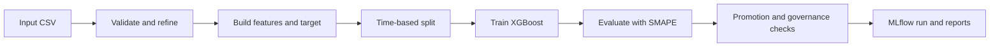

# 📦 Parcel Volume Forecast

> A beginner-friendly machine-learning project for forecasting parcel volumes, evaluating results over time, and recording each run for review.

[](https://github.com/baskaraishu/ML_Engineering_Repo/actions/workflows/ci.yml)


---

## 🎯 Project overview

This repository demonstrates a practical forecasting workflow using a time-aware train/validation/test split and an XGBoost regressor. It includes data checks, forecast evaluation, promotion gates, MLflow tracking, and a business-readable run report.

The repository root is the project root. Run the commands below directly from the checked-out repository; no nested project directory is required.

## 🔄 Workflow



## 📊 Input data

The configured input is [`data/multi_client_ib_uplift.csv`](data/multi_client_ib_uplift.csv). Its five columns are:

| Column | Meaning |
| --- | --- |
| `event_date` | Date associated with the parcel-volume observation |
| `actual_volume` | Observed parcel volume |
| `rolling_4w_median` | Four-week median volume used as the baseline |
| `is_china` | Indicator for the China cohort |
| `is_domestic` | Indicator for the domestic cohort |

The model target is derived during training from actual volume and the baseline; it does not need to be present in the input CSV.

## 🧰 Technology

- Python 3.12
- pandas and NumPy for data handling
- XGBoost for forecasting
- MLflow for experiment tracking and artifacts
- pytest for automated tests
- GitHub Actions for continuous integration and scheduled smoke runs

## 🗂️ Repository layout

```text
.
├── .github/workflows/ci.yml  # CI and scheduled smoke run
├── data/                     # Configured input CSV
├── notebooks/                # Learning and exploration material
├── src/                      # Training, features, evaluation, reporting
├── tests/                    # Unit and regression tests
├── plan.md                   # Staged project learning plan
├── requirements-dev.txt      # Development dependencies
└── README.md
```

## 🚀 Get started

Create and activate the project environment, then install dependencies:

```bash
python3.12 -m venv .venv
source .venv/bin/activate
python -m pip install --upgrade pip
python -m pip install -r requirements-dev.txt
```

## 🧪 Run the tests

```bash
python -m pytest -q
```

## ▶️ Run a forecast

```bash
python src/training/train_xgboost.py \
	--experiment parcel-volume-forecast-local \
	--dataset-version v1 \
	--run-mode debug
```

The input path defaults to `data/multi_client_ib_uplift.csv`, as set in [`src/config.py`](src/config.py). Debug mode runs training and reporting but deliberately does not recommend promotion.

## 📈 Run outputs

Runs are tracked locally in `mlruns/`. The MLflow run contains the trained model, evaluation and governance metrics, and report artifacts such as the JSON and HTML run summaries. The local tracking directory is generated output and is not committed to Git.

## ⚙️ GitHub Actions

The workflow in [`.github/workflows/ci.yml`](.github/workflows/ci.yml):

- runs the test suite and training smoke check on pushes and pull requests targeting `develop`, `main`, or `master`;
- runs daily at **09:00 UTC**; scheduled workflows execute from the repository's default branch;
- supports manual runs through **Actions → CI → Run workflow**.

## 🧭 Learning roadmap

See [`plan.md`](plan.md) for the stages from data ingestion through model evaluation, promotion checks, reporting, and scheduled automation.
